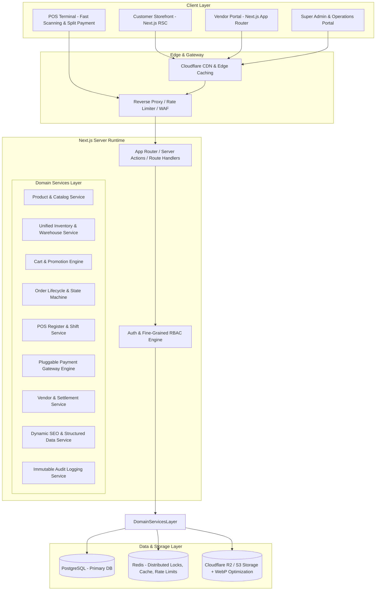
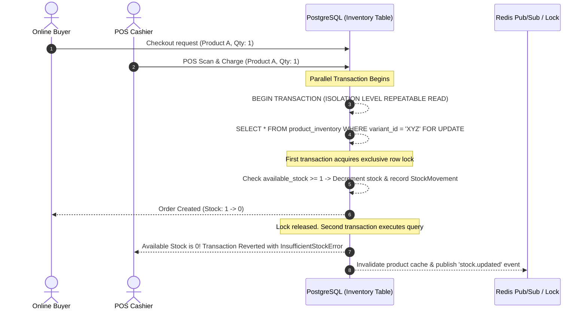

# Enterprise Multi-Vendor E-Commerce & Integrated POS Platform
## System Architecture Specification & Engineering Blueprint

---

### Executive Architecture Overview

This platform is architected as a **Modular Monolith** built on **Next.js (App Router)** with **TypeScript**, backed by **PostgreSQL** via **Prisma ORM**, with caching & atomic locks via **Redis**, and media assets delivered via **S3/Cloudflare R2**. 

It eliminates common e-commerce failure points (overselling, race conditions between physical POS and online channels, uncontrolled URL crawling, and brittle monolithic components) by establishing strict boundaries between domain services, server components, and transactional state machines.



---

## 1. Modular Domain Services Map

To avoid logic leakage across UI components and API handlers, all core business logic is encapsulated in isolated services under `src/services/`:

| Service | Responsibilities | Key Boundaries & Guardrails |
| :--- | :--- | :--- |
| **`ProductService`** | Catalogs, variants (color, size, storage), brands, specs, search indexes | Enforces valid SKU/barcode uniqueness, hierarchical category validation |
| **`InventoryService`** | Multi-warehouse stock, atomic reservations, stock movements, low-stock triggers | Single source of truth. Handles `SELECT ... FOR UPDATE` row locks to prevent overselling |
| **`POSService`** | Cashier shifts, register open/close cash balances, offline-tolerant barcode scan, receipt printing | Shared inventory and pricing pipeline with storefront; supports split tenders (cash/card/MFS) |
| **`CartService`** | Guest cart persistence, customer cart merge, real-time stock and server-calculated price verification | Never relies on client-submitted prices or stock values |
| **`OrderService`** | State machine (Pending -> Confirmed -> Packed -> Shipped -> Delivered / Cancelled / Refunded) | Atomic order placement with stock deduction and audit history in a single DB transaction |
| **`PaymentService`** | Gateway abstraction (SSLCommerz, bKash, Nagad, Stripe, COD, POS Card/Cash), idempotency | Verifies signatures and IPN/webhooks server-side; enforces replay attack prevention |
| **`VendorService`** | Vendor onboarding, multi-tier commissions, withdrawal requests, store policies | Isolates multi-vendor visibility: vendors can only see and mutate their own items |
| **`SEOService`** | JSON-LD (ProductGroup, Product, BreadcrumbList), canonical URLs, dynamic XML sitemaps, robots.txt | Prevents index bloat on faceted filters; generates clean crawl paths |
| **`AuditService`** | Immutable tamper-proof audit trail for sensitive mutations | Records actor, IP, timestamp, entity diffs (price change, stock adjustment, refund) |

---

## 2. Unified POS + Online Inventory Synchronization Architecture

### The Concurrency & Overselling Problem
In multi-channel retail, when a customer purchases the last unit online while a cashier scans it at the POS register, race conditions cause stock discrepancies. 

### The Solution: Row-Level Locking & Atomic Stock Movements


1. **Atomic Invariant:** Stock updates must occur inside an ACID transaction with pessimistic row-locking (`SELECT ... FOR UPDATE`) or optimistic concurrency control via a version column.
2. **Real-time POS Catalog Feed:** POS registers subscribe to Redis/WebSocket cache invalidation so cashiers have sub-second visibility into changing stock levels.
3. **Multi-Warehouse Allocation:** Every POS register is bound to a specific physical warehouse/store outlet. Online orders draw from regional distribution warehouses or local store pickups.

---

## 3. Database Entity-Relationship Model (PostgreSQL / Prisma)

### Core Schema Highlights

```prisma
enum UserRole {
  SUPER_ADMIN
  ADMIN
  VENDOR
  CUSTOMER
  POS_OPERATOR
  WAREHOUSE_STAFF
  DELIVERY_STAFF
  SUPPORT_STAFF
  ACCOUNTING_STAFF
}

enum OrderStatus {
  PENDING
  CONFIRMED
  PROCESSING
  PACKED
  SHIPPED
  OUT_FOR_DELIVERY
  DELIVERED
  CANCELLED
  RETURN_REQUESTED
  RETURNED
  REFUNDED
  PARTIALLY_REFUNDED
  FAILED
}

enum PaymentStatus {
  PENDING
  AUTHORIZED
  PAID
  PARTIALLY_PAID
  FAILED
  REFUNDED
}

enum PaymentMethodType {
  CASH_ON_DELIVERY
  POS_CASH
  POS_CARD
  MOBILE_FINANCIAL_SERVICE // bKash, Nagad, Rocket
  ONLINE_CARD
  BANK_TRANSFER
}

enum StockMovementType {
  PURCHASE_RECEIPT
  ONLINE_SALE
  POS_SALE
  RETURN_RESTOCK
  DAMAGE_WRITE_OFF
  WAREHOUSE_TRANSFER
  MANUAL_ADJUSTMENT
}
```

### Relational Entity Groups:
1. **Security & Identity:** `User`, `Role`, `Permission`, `RolePermission`, `UserSession`, `AuditLog`.
2. **Vendors & Stores:** `VendorProfile`, `VendorPayout`, `CommissionConfig`, `VendorReview`.
3. **Catalog & Attributes:** `Category`, `Brand`, `Product`, `ProductVariant`, `Attribute`, `AttributeValue`, `ProductImage`.
4. **Inventory & Warehouses:** `Warehouse`, `InventoryItem`, `StockMovement`, `StockReservation`.
5. **Cart & Orders:** `Cart`, `CartItem`, `Order`, `OrderItem`, `OrderStatusHistory`, `Coupon`, `DiscountRule`.
6. **POS Terminal Operations:** `PosRegister`, `PosSession` (with opening/closing cash balances), `PosTransaction`, `CashMovement`.
7. **Billing & Shipping:** `PaymentTransaction`, `RefundRecord`, `ShippingZone`, `ShippingRate`, `Address`.
8. **SEO & CMS:** `SeoMetadata`, `RedirectRule`, `CmsPage`, `Banner`, `BlogPost`.

---

## 4. Fine-Grained Role-Based Access Control (RBAC)

Rather than checking basic role strings (e.g. `role === 'ADMIN'`), the platform enforces granular permission tokens:

```
pos:session:open
pos:session:close
pos:orders:create
pos:orders:refund
inventory:stock:adjust
inventory:warehouse:transfer
catalog:products:create
catalog:products:publish
catalog:prices:override
vendor:payout:request
vendor:payout:approve
orders:status:update
orders:cancel
financial:reports:view
```

* **Server Action & Route Guard Middleware:** Checks user session JWT/Token, loads cached permissions, and aborts with standard RFC 7807 problem details if unauthorized.
* **Multi-tenant Data Isolation:** All queries performed by `VENDOR` users automatically inject `WHERE vendor_id = session.vendorId`.

---

## 5. SEO Architecture & Crawl Optimization

### Faceted Navigation & Crawl Budget Protection
Uncontrolled combinations of query parameters (e.g. `?color=blue&size=xl&sort=price_asc&page=3`) can deplete search crawl budgets and produce duplicate content penalties.
* **Canonical Canonicalization:** All filtered search/category pages point their `canonical` URL to the clean parent category (`/category/electronics/mobile-phones`) unless an explicit SEO-curated landing page exists.
* **Strict Robots Meta Tag:** Dynamic faceted combinations containing sorting or non-essential filter tags automatically emit `<meta name="robots" content="noindex, follow" />`.
* **Clean Slugs:** All URLs are lowercase, human-readable kebab-case:
  * `/products/[slug]`
  * `/category/[parent-slug]/[child-slug]`
  * `/brand/[brand-slug]`
  * `/store/[vendor-slug]`
* **Initial HTML JSON-LD Structured Data:**
  * Schema.org `Product` & `ProductGroup` embedded directly in Server Components output for instant indexing by Google Merchant / Search bots.
  * `BreadcrumbList` for breadcrumb SERP enhancements.
  * Real prices, actual stock states (`https://schema.org/InStock` / `OutOfStock`), without spoofing.

---

## 6. Directory Structure (Next.js App Router Monorepo-Ready Layout)

```
d:/Next JS/
├── .env.example
├── .gitignore
├── next.config.ts
├── package.json
├── tsconfig.json
├── prisma/
│   ├── schema.prisma
│   └── seed.ts
├── public/
│   ├── favicon.ico
│   ├── robots.txt
│   └── uploads/
├── src/
│   ├── app/
│   │   ├── (storefront)/              # Public customer-facing storefront
│   │   │   ├── layout.tsx
│   │   │   ├── page.tsx               # High-converting dynamic homepage
│   │   │   ├── products/[slug]/       # Product detail page (RSC + JSON-LD)
│   │   │   ├── category/[...slug]/    # Category & subcategory hierarchy
│   │   │   ├── brand/[slug]/          # Brand listing
│   │   │   ├── store/[slug]/          # Multi-vendor store showcase
│   │   │   ├── cart/                  # Cart with guest/user sync
│   │   │   ├── checkout/              # Multi-step checkout with server validation
│   │   │   └── account/               # Customer order history, addresses, wishlist
│   │   ├── (dashboard)/               # Unified portal for back-office operations
│   │   │   ├── admin/                 # Super Admin & Staff controls
│   │   │   ├── vendor/                # Vendor store management & analytics
│   │   │   └── warehouse/             # Logistics, stock receipt & dispatch
│   │   ├── (pos)/                     # High-speed point-of-sale terminal UI
│   │   │   ├── terminal/
│   │   │   └── shift/
│   │   ├── api/                       # REST & webhook endpoints
│   │   │   ├── auth/
│   │   │   ├── webhooks/
│   │   │   └── v1/
│   │   ├── sitemap.ts                 # Dynamic XML sitemap index & splits
│   │   └── robots.ts                  # Dynamic robots.txt generation
│   ├── components/
│   │   ├── ui/                        # Accessible primitive components
│   │   ├── storefront/                # Product cards, mega menu, search modal
│   │   ├── dashboard/                 # Metrics, data tables, audit timelines
│   │   └── pos/                       # Barcode scanner input, keypad, receipt
│   ├── lib/
│   │   ├── db.ts                      # Prisma client singleton
│   │   ├── redis.ts                   # Redis client & distributed lock utility
│   │   ├── auth.ts                    # JWT / Session authentication helpers
│   │   ├── rbac.ts                    # Permission verification helpers
│   │   └── utils.ts                   # Currency formatting, slugify, validation
│   ├── services/                      # Decoupled business logic (No UI code)
│   │   ├── product.service.ts
│   │   ├── inventory.service.ts
│   │   ├── pos.service.ts
│   │   ├── cart.service.ts
│   │   ├── order.service.ts
│   │   ├── payment.service.ts
│   │   ├── vendor.service.ts
│   │   ├── seo.service.ts
│   │   └── audit.service.ts
│   └── types/                         # Enterprise TypeScript definitions
```

---

## 7. Phased Implementation Plan

* **Phase 1: Project Initialization & Core Framework Setup**
  * Initialize Next.js 15+ with App Router, TypeScript, ESLint, and Tailwind CSS in `d:\Next JS`.
  * Set up Docker Compose for local PostgreSQL and Redis.
  * Configure environment variables (`.env.example`).
* **Phase 2: Database Schema & Entity Relationships**
  * Create `schema.prisma` covering Users, RBAC, Catalog, Inventory, Orders, POS, and Auditing.
  * Implement database seed script with sample vendors, categories, products, inventory, and staff roles.
* **Phase 3: Authentication & RBAC Engine**
  * Multi-role JWT session management with secure cookies.
  * Middleware and Server Action authorization guards.
* **Phase 4: Inventory & Unified Stock Service**
  * Implement `InventoryService` with atomic transactions, reservation timers, and POS-online sync.
* **Phase 5: Catalog & Product Management (Admin & Vendor)**
  * Product CRUD with variants (SKU, barcode, attributes, media).
* **Phase 6: High-Performance Customer Storefront**
  * Fast Server Component catalog, product pages, dynamic SEO metadata, and JSON-LD schema.
* **Phase 7: Cart, Multi-Step Checkout & Orders**
  * Server-validated cart, address management, coupon calculation, and multi-vendor order generation.
* **Phase 8: Point of Sale (POS) Terminal Interface**
  * Barcode scanner integration, fast product lookup, split payments, cash drawer session management, and receipt printing.
* **Phase 9: Payments & Bangladesh-Ready Integrations**
  * Pluggable payment engine (COD, bKash/Nagad MFS simulation/webhook, cards).
* **Phase 10: Performance Optimization, Security Audit & Verification**
  * Audit Core Web Vitals, SSR caching, rate limiting, and automated test coverage.
